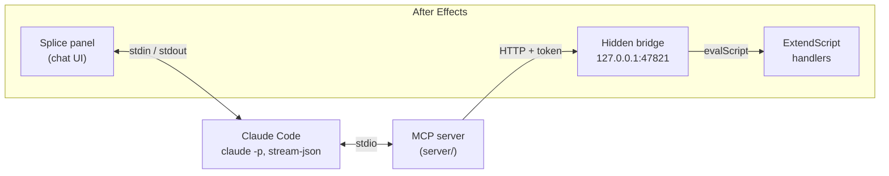

# Splice

**Claude Code, docked inside Adobe After Effects.**

Splice adds a chat panel to After Effects that runs [Claude Code](https://claude.com/claude-code) on your own subscription. Claude sees the comp you're in and the layers you've selected, and edits the project directly through 44 tools: cutting to scene changes, placing markers on the beat, applying effects, writing expressions. Every change is one undo step.

> Unofficial community project. Not affiliated with or endorsed by Anthropic or Adobe.

## What it does

- **Chat in a docked panel** (Window > Extensions > Splice). Replies stream in, tool calls show up inline, and you approve anything outside the After Effects tools.
- **Knows what you mean by "these".** Each message carries a snapshot of the active comp, playhead and selected layers, so "make these fade in" works.
- **Can look at your comp.** Attach the current frame as an image with one click.
- **Built for editing, not just motion graphics.** Scene-cut detection, cutting and packing clips, beat markers from the audio waveform, browsing and previewing media on disk before importing it.
- **Fast.** A hidden bridge inside After Effects receives commands over localhost, so a tool call takes milliseconds instead of a file-polling round trip.
- **Safe by default.** Every write is a single undo step. ExtendScript that Claude writes always shows up in an Allow card before it runs.
- **No API key.** It uses your existing Claude Code login, so there are no per-request charges on top of your plan.

## Requirements

- macOS (Windows isn't supported yet)
- After Effects 2022 or newer
- [Node.js](https://nodejs.org) 18 or newer
- [Claude Code](https://claude.com/claude-code), installed and logged in (a Claude Pro or Max plan, or an API account)
- Xcode Command Line Tools (`xcode-select --install`) for scene detection and media previews, which compile small Swift helpers on first use

## Install

```bash
git clone https://github.com/askel-dev/splice-ae.git
cd splice-ae
node install.js
```

The installer:

1. builds the MCP server in `server/`,
2. copies the extension to `~/Library/Application Support/Adobe/CEP/extensions/splice` and turns on `PlayerDebugMode`, which unsigned extensions need,
3. registers the server with Claude Code as `AfterEffectsMCP` (user scope). Pass `--no-mcp` to skip this.

Restart After Effects, then open **Window > Extensions > Splice**.

To update, `git pull` and run `node install.js` again.

## Try asking

- "Put markers on the beats of the music"
- "Cut the selected clip at every scene change and close the gaps"
- "Add a subtle vignette to this comp"
- "Explain what the expressions on the selected layers do"
- "Look at this frame. Why does the text look soft?"

## Permission modes

Pick one from the toolbar:

| Mode | What runs without asking |
|---|---|
| **AE tools auto** (default) | After Effects tools, reading files, web search. Everything else asks. |
| **Auto mode** | Claude Code's auto mode decides, After Effects tools always allowed. |
| **Ask every time** | Only reading files. |

In every mode, ExtendScript that Claude writes (`execute-jsx`) asks first.

## Tools

| Area | Tools |
|---|---|
| Editing | `detect-scene-cuts`, `split-layer`, `close-gaps`, `cut-to-markers`, `arrange-clips`, `update-layers`, `get-layer-clip-frames` |
| Media | `browse-media`, `preview-media`, `detect-media-shots`, `import-clips`, `list-project-items` |
| Audio and markers | `get-audio-info`, `analyze-audio-waveform`, `set-audio-levels`, `add-marker`, `add-markers-bulk`, `get-markers` |
| Effects and animation | `apply-effect`, `add-any-effect`, `apply-effect-template`, `list-layer-effects`, `list-available-effects`, `set-effect-property`, `set-effect-keyframe`, `remove-effect`, `list-presets`, `search-presets`, `apply-preset`, `setLayerKeyframe`, `setLayerExpression`, `test-animation` |
| Comps and layers | `create-composition`, `create-adjustment-layer`, `center-layers`, `get-frames` |
| Scripting | `execute-jsx`, `run-script`, `get-results`, `get-help`, `run-bridge-test` |

The server works from any Claude Code session, not just the panel. With After Effects open, you can drive it from your terminal too.

## How it works



- The panel starts `claude -p` with stream-json input and output and relays permission prompts back as Allow/Deny cards.
- The MCP server sends each command to the bridge, authenticated with a random token that is rewritten on every launch to `~/Documents/ae-mcp-bridge/http-bridge.json`. The bridge only listens on localhost.
- The bridge runs commands one at a time through `evalScript`, wrapping each write in an undo group.

| Path | What it is |
|---|---|
| `CSXS/manifest.xml` | CEP manifest for the panel and the hidden bridge |
| `panel/` | Chat UI: `app.js`, `claude-session.js` (runs Claude Code), `markdown.js`, `style.css` |
| `bridge/`, `shared/bridge-server.js` | Background extension and the HTTP server that runs commands |
| `jsx/` | ExtendScript: command handlers and the comp/selection snapshot |
| `server/` | The MCP server (TypeScript) and Swift helpers for media analysis |
| `install.js` | Installer |

## Development

```bash
node install.js --link --debug
```

`--link` symlinks the repo into the CEP folder, so panel edits show up when you close and reopen the panel. `--debug` opens Chrome DevTools at `http://localhost:8092` (panel) and `:8093` (bridge). After changing `server/src`, run `npm run build` in `server/` and restart the Claude session in the panel (the **+** button).

CEP renders panels offscreen at a fixed 30 fps on macOS, so the panel avoids continuous animation. Streamed text is revealed at a steady pace per frame, the working indicator steps through glyphs instead of rotating, and scrolling never forces a synchronous layout.

## Troubleshooting

- **No Splice in the Extensions menu:** run `node install.js` again and fully restart After Effects.
- **"Claude Code isn't logged in":** run `claude` in Terminal once and use `/login`.
- **The toolbar says "Bridge error":** restart After Effects. If it stays, install with `--debug` and check the console at `http://localhost:8093`.
- **Frames or presets fail to save:** turn on **Allow Scripts to Write Files and Access Network** in After Effects' Scripting & Expressions settings.
- **Claude chats but can't edit:** check `claude mcp get AfterEffectsMCP` shows the server as connected.

## Credits

The MCP server and ExtendScript handlers started from [after-effects-mcp](https://github.com/TheLlamainator/after-effects-mcp) by Dakkshin (MIT) and have been extended a lot since: the HTTP bridge, the editing, media and audio tools, and the panel.

## License

[MIT](LICENSE)
